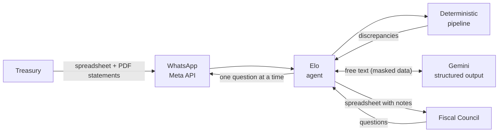

# Elo: revenue reconciliation agent for a Fiscal Council

*[Versão em português](README.md)*

[](https://github.com/ataideray/revenue-reconciliation-agent/actions/workflows/testes.yml)


**Elo** reconciles an association's monthly revenue: it matches every
receipt issued by the treasury to the Pix transfers (Brazil's instant payment
system) in the bank statements, and asks the
treasury, over WhatsApp, only about what doesn't match. The Fiscal Council (the
association's oversight board, "CF") receives the month already explained with
notes, in a spreadsheet in the same order as the bank statements.

**Results:** The Council's review went from about
**4 hours**, with **2–3 day** pauses waiting on the treasury, to about
**1 hour**, with the explanations ready before it starts.

> Pilot Project in use by an association. This public version uses **fictional data
> only** (`exemplo/`): names, amounts, revenue destinations and the association
> were replaced.

## See it working

https://github.com/user-attachments/assets/675c01b7-8640-45ae-b7e2-dbab91429d0c

*Elo in production (Azure and the WhatsApp API), with the fictional July in
`exemplo/`: the treasury sends the three files, Elo reconciles July and asks
about the discrepancies one at a time; then the Fiscal Council receives the
package and asks a question about the month. The chat is in Portuguese.*

## The problem

Every month, the treasury hands over a spreadsheet with hundreds of receipts
(annual fees, canteen, bazaar, offerings…) and the bank statements.
Checking each receipt by hand is slow, and many differences have simple
explanations:
- a husband paid his wife's annual fee;
- a member's company sent the Pix;
- the name was misspelled on the receipt;
- a Pix was refunded.

## The solution

1. **Deterministic pipeline:**
   - reads the bank PDFs and checks the parsing against the PDF itself;
   - reads the treasury's revenue spreadsheet;
   - matches receipts and Pix transfers (including two transfers adding up
     to one receipt);
   - suggests links between different accounts and people, and possible
     refunds;
   - produces a spreadsheet for the Council and a JSON file for the agent.
2. **Conversational agent (Elo):**
   - asks the treasury **one discrepancy at a time**, with buttons ("Yes:
     receipt 0814", "No", "Answer later"), each Pix shown next to its
     suggested receipt, and "CNPJ" (company tax ID) before company names;
   - records the explanations as notes;
   - delivers the closed month to the Council;
   - answers the Council's questions ("how much did the bazaar bring in July?",
     "was July better than June?").
3. **AI only for language:**
   - Gemini understands free-text answers ("yes, it's his wife"), drafts
     the note and answers the Council;
   - every number comes from code, and the AI returns validated JSON;
   - no confirmation counts without the treasury's click;
   - some predictable answers ("yes, it's his wife") don't even go to the AI.



## Technical highlights

- **The AI never decides numbers.** Matching receipts and transfers, sums
  and month comparisons are deterministic code. The AI only handles
  language and returns validated JSON; a note citing an amount missing from
  the data is discarded.
  → [`agente/ia.py`](src/conselho_fiscal/agente/ia.py) (`_conferir`)
- **Nothing between different names is automatic.** A husband's Pix for his
  wife's receipt becomes a ranked suggestion (previously confirmed account,
  shared surname, similar name, unique amount) that the treasury confirms.
  → [`receitas/conciliacao.py`](src/conselho_fiscal/receitas/conciliacao.py)
  (`sugerir_vinculos`, `sugerir_devolucoes`)
- **Privacy before the AI (LGPD, Brazil's data protection law).** Names
  become aliases (PESSOA_A…) and tax IDs are masked before sending; the
  aliases are reversed on the way back.
  → [`agente/ia.py`](src/conselho_fiscal/agente/ia.py) (`Apelidos`)
- **The bank PDF is the source of truth.** Custom parsers for two layouts,
  with the parsing checked against the PDF itself (balances, totals) and the
  page of each transaction.
  → [`extratos/cora.py`](src/conselho_fiscal/extratos/cora.py),
  [`extratos/stone.py`](src/conselho_fiscal/extratos/stone.py)
  (`verificar_leitura`)
- **Flag, don't block.** A PDF that doesn't add up or an AI outage becomes
  a warning, and processing continues. Gemini has a fallback model and,
  with neither available, the agent keeps working.
  → [`agente/gemini.py`](src/conselho_fiscal/agente/gemini.py)

Also: WhatsApp Cloud API with signed webhooks and a per-number queue; Docker
on Azure Container Apps with scale-to-zero; automated tests on every push
(GitHub Actions) and an AI evaluation.

The reasoning behind each choice is in [docs/decisoes.md](docs/decisoes.md)
(Portuguese).

## Run it in 1 minute

Requires **Python 3.11+**. From the project folder:

```bash
python3 -m venv .venv && source .venv/bin/activate
pip install -e ".[agente,dev]"
conselho-fiscal agente --demo --ia nenhuma
```

Open **http://127.0.0.1:8000** in your browser. The page is a **simulator**
that mimics two WhatsApp chats side by side (the interface is in
Portuguese).
- **Tesouraria** (treasury, left): use 📎 to send the three files in
  `exemplo/2026-06/`. Elo reconciles the month and starts asking; answer
  with the buttons or in writing ("sim, é a esposa dele", "corrigir Helio").
  Then do the same with `exemplo/2026-07/`.
- **Conselho Fiscal** (right): once the months are closed, ask "manda julho"
  or "quanto entrou de bazar em junho e julho?".

The example months were built on purpose, to protect the association's real
data.

**What this local version leaves out:**
- **WhatsApp and Azure:** in production, Elo talks through the official
  WhatsApp API and runs on Azure. That requires the association's accounts
  and keys, which are not part of the repository; locally, the simulator
  plays WhatsApp's role, with the same agent behind it.
- **AI (Gemini):** the AI needs an API key, which is personal and not in the
  repository. With `--ia nenhuma` ("no AI"), Elo runs without it: buttons,
  fixed rules and Council queries work normally, and a free-text answer
  becomes the note as written. Comparing months ("julho foi melhor que
  junho?") needs the AI. To see the AI, create a free key in
  [Google AI Studio](https://aistudio.google.com/apikey) and run
  `GEMINI_API_KEY=<your key> conselho-fiscal agente --demo`.
- **Bank PDFs:** the example uses fictional statements in .xlsx, which
  `--demo` accepts instead of PDFs (without the parsing check, which only
  exists for PDFs).

**Other commands:**

```bash
# reconciliation from the command line (the output is also in exemplo/resultado/)
conselho-fiscal receitas exemplo/2026-07/entradas.xlsx exemplo/2026-07/cora.xlsx \
                         exemplo/2026-07/stone.xlsx saidas/receitas_2026-07.xlsx

python3 -m unittest discover -s tests -t .      # tests (or: pytest)
python3 scripts/gerar_exemplo.py                # rebuilds the fictional months in exemplo/
```

## Structure

```
src/conselho_fiscal/
  extratos/     bank statements PDF parsing into a single transaction format
  receitas/     treasury spreadsheet, reconciliation, final spreadsheet and JSON
  cadastros/    revenue destinations and confirmed links (kept for 2 years)
  agente/       conversation (agente.py), AI (ia.py, gemini.py), WhatsApp, Council queries, web
  comum/        text, amounts, PDF and spreadsheet styles
  cli.py        command line: receitas, extrato, agente
exemplo/        fictional months (receipts and statements in .xlsx), generated results and AI evaluation cases
scripts/        build the example, evaluate the AI
tests/unit/     tests with fictional data
docs/           decisions, architecture, usage, agent and Azure hosting
```

The code, comments and docs are in Portuguese, the language of the users.

## Documentation (Portuguese)

- [docs/decisoes.md](docs/decisoes.md): design decisions and why
- [docs/arquitetura.md](docs/arquitetura.md): modules and data flow
- [docs/receitas.md](docs/receitas.md): the revenue reconciliation and how to read the result
- [docs/agente.md](docs/agente.md): the agent, the AI and WhatsApp
- [docs/azure.md](docs/azure.md): Azure hosting, step by step, and costs

## Next steps

The Pilot Project covers revenue. Elo was organized to grow into new reviews:
- **Expense reconciliation:** the month's payments against the bank
  statements. Statement parsing already returns outgoing transfers, and the
  new pipeline can reuse the `extratos`, `comum` and `cadastros` modules.
- **Invoice reconciliation:** linking each expense to its invoice.

The module map and extension points are in
[docs/arquitetura.md](docs/arquitetura.md).

## Stack

Python 3.11+ · pandas · openpyxl · FastAPI · Gemini (REST, structured output) ·
WhatsApp Cloud API · Docker · Azure Container Apps · Azure Files · unittest ·
built with the help of Claude Code
