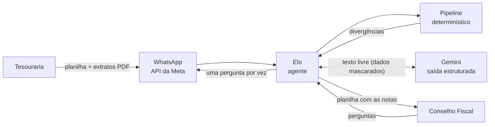

# Elo: agente de conferência de receitas para um Conselho Fiscal

*[English version](README.en.md)*

[](https://github.com/ataideray/revenue-reconciliation-agent/actions/workflows/testes.yml)


O **Elo** confere as receitas do mês de uma associação: liga cada recibo
emitido pela tesouraria aos Pix dos extratos bancários e pergunta à tesouraria,
pelo WhatsApp, só o que não bate. O Conselho Fiscal (CF) recebe o mês já
explicado com notas, numa planilha na mesma ordem do extrato.

**Resultado:** A conferência do CF passou de cerca de **4 horas**, com pausas
de **2 a 3 dias** esperando a tesouraria, para cerca de **1 hora**, com as
explicações prontas antes de começar.

> Projeto Piloto em uso por uma associação. Esta versão pública usa só **dados
> fictícios** (`exemplo/`): nomes, valores, destinos e a associação foram trocados.

## Veja funcionando

https://github.com/user-attachments/assets/675c01b7-8640-45ae-b7e2-dbab91429d0c

*O Elo em produção (Azure e API do WhatsApp), com o julho fictício de
`exemplo/`: a tesouraria envia os três arquivos, o Elo confere julho e
pergunta as divergências uma por vez; depois, o Conselho Fiscal recebe o
pacote e faz uma pergunta sobre o mês.*

## O problema

Todo mês, a tesouraria entrega uma planilha com centenas de recibos
(anuidades, cantina, bazar, ofertas…) e os extratos dos bancos. Conferir
à mão recibo por recibo é lento, e muitas diferenças têm explicação simples:
- o marido pagou a anuidade da esposa;
- a empresa do associado fez o Pix;
- o nome saiu escrito errado no recibo;
- um Pix foi devolvido.

## A solução

1. **Pipeline determinístico:**
   - lê os PDFs dos bancos e confere a leitura contra o próprio PDF;
   - lê a planilha de receitas da tesouraria;
   - liga recibos e Pix (inclusive dois Pix somados);
   - sugere vínculos entre contas e pessoas diferentes, e possíveis
     devoluções;
   - gera uma planilha para o CF e um JSON para o agente.
2. **Agente de conversa (Elo):**
   - pergunta à tesouraria **uma divergência por vez**, com botões ("Sim:
     recibo 0814", "Não", "Responder depois"), cada Pix já ao lado do
     recibo sugerido e "CNPJ" na frente do nome quando é de empresa;
   - registra as explicações como notas;
   - entrega o mês fechado ao CF;
   - responde perguntas do CF ("quanto deu o bazar em julho?", "julho foi
     melhor que junho?").
3. **IA só para a linguagem:**
   - o Gemini entende a resposta livre ("sim, é a esposa dele"), redige a
     nota e responde ao CF;
   - todo número vem do código, e a IA devolve um JSON validado;
   - nenhuma confirmação vale sem o clique da tesouraria;
   - algumas respostas previsíveis ("sim, é a esposa dele") nem passam pela IA.



## Destaques técnicos

- **A IA não decide números.** Ligar recibos e Pix, somar e comparar meses é
  código determinístico. A IA só cuida da linguagem e devolve um JSON
  validado; uma nota que cita um valor ausente dos dados é descartada.
  → [`agente/ia.py`](src/conselho_fiscal/agente/ia.py) (`_conferir`)
- **Nada entre nomes diferentes é automático.** O Pix do marido para o
  recibo da esposa vira uma sugestão ranqueada (conta já confirmada, nome
  em comum, nome parecido, valor único) que a tesouraria confirma.
  → [`receitas/conciliacao.py`](src/conselho_fiscal/receitas/conciliacao.py)
  (`sugerir_vinculos`, `sugerir_devolucoes`)
- **Privacidade antes da IA (LGPD).** Nomes viram apelidos (PESSOA_A…) e
  CPFs são mascarados antes do envio; na volta, os apelidos são desfeitos.
  → [`agente/ia.py`](src/conselho_fiscal/agente/ia.py) (`Apelidos`)
- **O PDF do banco é a fonte oficial.** Parsers próprios para dois layouts,
  com a leitura conferida contra o próprio PDF (saldos, totais) e a página
  de cada lançamento.
  → [`extratos/cora.py`](src/conselho_fiscal/extratos/cora.py),
  [`extratos/stone.py`](src/conselho_fiscal/extratos/stone.py)
  (`verificar_leitura`)
- **Sinalizar, não bloquear.** Um PDF que não fecha ou a IA fora do ar
  viram alertas, e o processamento segue. O Gemini tem modelo reserva e,
  sem nenhum, o agente continua funcionando.
  → [`agente/gemini.py`](src/conselho_fiscal/agente/gemini.py)

Também: WhatsApp Cloud API com webhook assinado e fila por número; Docker
no Azure Container Apps com escala a zero; testes automáticos a cada push
(GitHub Actions) e uma avaliação da IA.

O porquê de cada escolha está em [docs/decisoes.md](docs/decisoes.md).

## Rodar em 1 minuto

Requer **Python 3.11+**. Na pasta do projeto:

```bash
python3 -m venv .venv && source .venv/bin/activate
pip install -e ".[agente,dev]"
conselho-fiscal agente --demo --ia nenhuma
```

Abra **http://127.0.0.1:8000** no navegador. A página é um **simulador**:
imita duas conversas de WhatsApp lado a lado.
- **Tesouraria** (à esquerda): pelo 📎, envie os três arquivos de
  `exemplo/2026-06/`. O Elo confere o mês e começa a perguntar; responda pelos
  botões ou por escrito ("sim, é a esposa dele", "corrigir Helio"). Depois,
  faça o mesmo com `exemplo/2026-07/`.
- **Conselho Fiscal** (à direita): com os meses fechados, peça "manda julho" ou
  pergunte "quanto entrou de bazar em junho e julho?".

Os meses de exemplo foram montados de propósito, para preservar os dados reais
da associação.

**O que fica de fora nesta versão local:**
- **WhatsApp e Azure:** em produção, o Elo conversa pela API oficial do
  WhatsApp e roda no Azure. Isso exige contas e chaves da associação, que não
  fazem parte do repositório; localmente, o simulador faz o papel do
  WhatsApp, com o mesmo agente por trás.
- **IA (Gemini):** a IA precisa de uma chave de API, que é pessoal e não vem
  no repositório. Com `--ia nenhuma`, o Elo roda sem IA: botões, regras fixas
  e consultas funcionam normalmente, e uma resposta livre vira a nota como
  foi escrita. A comparação entre meses ("julho foi melhor que junho?")
  precisa da IA. Para ver a IA, crie uma chave gratuita no
  [Google AI Studio](https://aistudio.google.com/apikey) e rode com
  `GEMINI_API_KEY=<sua chave> conselho-fiscal agente --demo`.
- **PDFs dos bancos:** o exemplo usa extratos fictícios em .xlsx, que o
  `--demo` aceita no lugar dos PDFs (sem a conferência da leitura, que só
  existe para o PDF).

**Outros comandos:**

```bash
# conferência pela linha de comando (a planilha gerada também está em exemplo/resultado/)
conselho-fiscal receitas exemplo/2026-07/entradas.xlsx exemplo/2026-07/cora.xlsx \
                         exemplo/2026-07/stone.xlsx saidas/receitas_2026-07.xlsx

python3 -m unittest discover -s tests -t .      # testes (ou: pytest)
python3 scripts/gerar_exemplo.py                # recria os meses fictícios de exemplo/
```

## Estrutura

```
src/conselho_fiscal/
  extratos/     leitura dos PDFs dos extratos bancários, num formato único de transação
  receitas/     planilha da tesouraria, conciliação, planilha final e JSON
  cadastros/    destinos de receita e vínculos confirmados (guarda de 2 anos)
  agente/       conversa (agente.py), IA (ia.py, gemini.py), WhatsApp, consultas do CF, web
  comum/        texto, valores, PDF e estilos de planilha
  cli.py        linha de comando: receitas, extrato, agente
exemplo/        meses fictícios (entradas e extratos em .xlsx), resultado gerado e casos de avaliação da IA
scripts/        gerar o exemplo, avaliar a IA
tests/unit/     testes com dados fictícios
docs/           decisões, arquitetura, uso, agente e hospedagem no Azure
```

## Documentação

- [docs/decisoes.md](docs/decisoes.md): as decisões de projeto e o porquê
- [docs/arquitetura.md](docs/arquitetura.md): módulos e fluxo de dados
- [docs/receitas.md](docs/receitas.md): a conferência de receitas e como ler o resultado
- [docs/agente.md](docs/agente.md): o agente, a IA e o WhatsApp
- [docs/azure.md](docs/azure.md): hospedagem no Azure, passo a passo e custos

## Próximos passos

O Projeto Piloto cobre as receitas. O Elo foi organizado para crescer em novas
conferências:
- **Conferência de saídas:** os pagamentos do mês contra os extratos. A
  leitura dos extratos já devolve as saídas, e o pipeline novo pode
  reaproveitar os módulos `extratos`, `comum` e `cadastros`.
- **Conferência de notas fiscais:** ligar cada saída à sua nota.

O mapa dos módulos e os pontos de extensão estão em
[docs/arquitetura.md](docs/arquitetura.md).

## Stack

Python 3.11+ · pandas · openpyxl · FastAPI · Gemini (REST, saída estruturada) ·
WhatsApp Cloud API · Docker · Azure Container Apps · Azure Files · unittest ·
Claude Code
